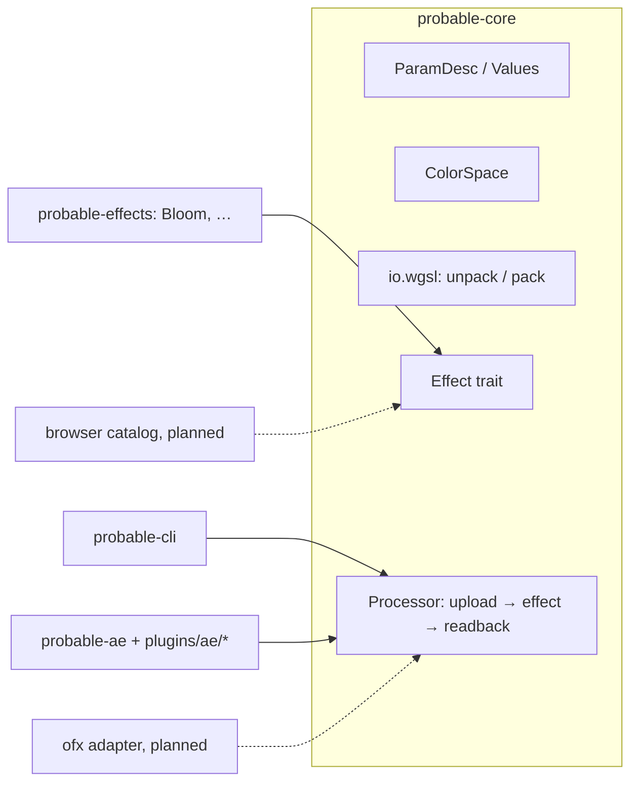

# Probable Effects: architecture and plan

Probable Effects turns the post-processing and stylise effects of
[probable-video-editor](https://github.com/FuouM/probable-video-editor) (pve) into host plugins:
After Effects and Premiere Pro first, then OpenFX (Resolve, Fusion, Nuke, Vegas, Natron), and a
browser catalog to preview effects without installing anything.

## Decisions

| Topic | Decision |
|---|---|
| Scope | Effects, not pve scenes. Tier 1 (post) and Tier 2 (stylise looks). Enough building blocks that a pve video could be rebuilt in AE by hand. |
| Packaging | One plugin per effect (`Probable Bloom`, `Probable Grain`, …), AE category `Probable`. No combined "finish" effect. |
| Hosts | AE 2025 + Premiere now. OFX once the AE path is solid. Browser catalog after that. |
| Platform | Windows x64 only (no macOS signing/notarisation work). |
| Parity with pve | Not required. pve's look is the reference, not a pixel target. |
| Colour | Effects compute in linear light, Rec.709 primaries, premultiplied f32. Hosts' pixels are converted on the GPU from the chosen working space (see [Colour](#colour)). |
| Language | Rust (2024 edition), workspace with a repo-local toolchain (`setup_env.ps1` / `env.ps1`). |
| GPU | wgpu 30, WGSL shaders (see [Shader language](#shader-language)). GPU required. |
| Audio | A separate `Probable Audio` effect analyses a layer's audio and bakes pve-style signals into keyframes on its own sliders; other effects link to them with expressions. |
| License | AGPL-3.0 (repository `LICENSE`). Adobe SDK bindings come from the MIT/Apache `after-effects` crates. |

## Layout

```
crates/core        probable-core     params, colour spaces, host pixel I/O, Effect trait, GPU device + pools
crates/effects     probable-effects  every effect (Rust + WGSL), for_each_effect! registry
crates/cli         probable-cli      `probable` binary: list / render / diff on still images
crates/ae          probable-ae       generic AE/Premiere adapter + export_effect! macro
crates/ae-build    probable-ae-build build.rs helper: PiPL resource and cfg flags for one plugin
plugins/ae/<name>  one cdylib per effect: build.rs (PiPL) + `export_effect!(Type)`
scripts/           ae-build / ae-install / ae-smoke (PowerShell), ae-smoke.jsx
tests/fixtures/    smoke.png test card
```



### The effect contract

```rust
pub trait Effect: Sized + Send + Sync + 'static {
    const INFO: EffectInfo;                 // name, match name, category, description
    const PARAMS: &'static [ParamDesc];     // UI order; stable ids
    const CAN_GROW: bool = false;           // offers "Grow Bounds"
    fn new(gpu: &Gpu) -> Self;              // build pipelines once per process
    fn margin(values: &Values, scale: [f32; 2]) -> [u32; 2];  // reach past the input, host px
    fn render(&self, cx: &mut RenderCx<'_>, values: &Values); // record GPU passes only
}
```

- `render` only records commands into `cx.encoder`: it reads `cx.src` (input canvas) and must
  fully write `cx.dst`. No host types, no blocking, no readback. That keeps an effect usable by
  every host, including the browser.
- Canvas: `rgba32float`, linear Rec.709 primaries, premultiplied, filterable. Effect-internal
  targets (bloom pyramid) may use `rgba16float`.
- `Frame` gives `time` (seconds), `scale` (host downsample: 0.5 in AE half-res previews; every
  pixel-sized param must be multiplied by it), `space` and `grow`.
- Helpers on `Gpu`: `fullscreen_module` (prepends a fullscreen-triangle vertex stage),
  `fullscreen_pipeline`, `bind`, `draw`, `uniform`, `texture` (pooled).

### Params

`ParamDesc { id, key, label, kind }` with `Float`, `Bool`, `Choice`. Rules:

- `id` is stored in AE projects. Never renumber or reuse it once released. Ids ≥ 900 belong to
  host-added params.
- `key` is the CLI / preset name, `label` the UI name.
- Every host appends the same host params after the effect's own: `Working Space` (always) and
  `Grow Bounds` (when `CAN_GROW`).

Colour, point and angle params get added when the first effect needs them (halation tint, CA
centre).

### Host pixel I/O

`Processor<E>::render(src, dst, frame, values)` takes host buffers described by `ImageDesc`
(width, height, stride, bottom-up rows, straight or premultiplied alpha, channel order ARGB / BGRA
/ RGBA, depth u8 / AE u16 (0..32768) / u16 / f32, origin). Rows are uploaded as they are; the
GPU does the swizzle, normalisation, alpha handling and colour decode (`io.wgsl`), so there is no
CPU conversion loop. Both images are placed by `origin` in one coordinate space and the effect runs
on their union, so `dst` may be larger than `src` (grow bounds) or smaller (AE region of interest).

`crates/core/tests/io_roundtrip.rs` checks that a passthrough effect returns every layout × colour
space × alpha mode × row order unchanged (one code value for integer formats).

### Colour

`Working Space` choices: sRGB, Linear (sRGB primaries), Rec.709 / BT.1886 (gamma 2.4), Rec.2020
(gamma 2.4), ACEScg, ACEScct. Decode: unpremultiply → transfer → gamut matrix to Rec.709 →
premultiply; encode is the exact inverse (matrix inverse computed in f64). Linear spaces skip the
unpremultiply step and round-trip exactly.

Known limits:
- Fully transparent pixels of straight-alpha hosts lose their colour (the canvas is premultiplied).
- Rec.2020's pure power curve behind a channel-mixing matrix turns f32 round-off on a zero channel
  into up to ~5e-4 of full scale near black.
- No automatic detection of AE's project working space yet; the user picks it. AE can report it
  (`ColorSettings` suite: working-space profile gamma, OCIO working space name), which is the
  planned `Auto` choice.
- No OpenColorIO: there is no native Rust OCIO; the fixed list covers common working spaces.

### After Effects / Premiere adapter

`probable_ae::export_effect!(probable_effects::Bloom)` expands the `after-effects` crate's
`define_effect!` with a generic `AePlugin<E>`:

- Params setup from `E::PARAMS` + host params.
- AE: SmartFX. SmartPreRender reads params, expands the input request by `E::margin` (light from
  just outside the requested region still lands inside), sets the result rect (grown when Grow
  Bounds is on) and stores params as pre-render data. SmartRender maps ARGB 8/16/32 bpc worlds by
  their `origin` and calls the `Processor`.
- Premiere: legacy Render with BGRA 8u / 32f.
- PiPL flags (`probable-ae-build`): DeepColorAware, SmartRender, FloatColorAware, threaded
  rendering (MFR), flattened sequence data; `NonParamVary` for time-varying effects. `build.rs`
  names are checked against `EffectInfo` at compile time.
- `panic = "unwind"` everywhere: debug and `catch_panics` builds turn panics into AE errors.

The `after-effects`, `premiere` and `pipl` crates are pinned to an upstream git commit: the
crates.io releases (0.4.0 / 0.1.1) lack the cfg flags and macro paths the adapter relies on.

Not done yet: AE's own GPU render path (zero-copy DX12 like Gyroflow), pixel aspect ratio, field
rendering, Premiere 16-bit.

### Shader language

Effects are WGSL. Options considered:

| Option | For | Against |
|---|---|---|
| **WGSL, hand-ported (chosen)** | wgpu's native language; the browser's WebGPU runs it as-is, so the catalog needs no translation step; naga validates at build/load time | One-time port of pve's GLSL; WGSL is stricter (no implicit int↔float, `select` instead of `?:`) |
| GLSL through naga's GLSL frontend | Less rewriting in theory | naga takes Vulkan-style GLSL 4.50: every pve shader still needs uniform blocks with set/binding, split samplers, `#version` changes; the browser would need GLSL→WGSL translation anyway |
| Rust-GPU (SPIR-V) | Shaders in Rust | Nightly toolchain, slow builds, browsers cannot load SPIR-V |
| Slang | One source to WGSL/HLSL/SPIR-V | Another toolchain to install and pin |

pve's `GLSL_COMMON` (hashes, simplex/fbm noise, curl, SDFs, `hatch`, `engrave`, `aaStroke`,
`luma`, palette constants) becomes `crates/effects/src/shaders/common.wgsl`, prepended like the
fullscreen stage, when the first Tier 2 effect needs it. pve's logical-1080p / `PX_SCALE`
conventions map to `Frame::scale` plus per-param pixel units.

## Development loop

```powershell
.\setup_env.ps1                     # once: repo-local Rust in .rust\ (+ sccache), writes env.yaml
. .\env.ps1                         # per shell
cargo test --workspace              # incl. GPU round-trip tests
cargo run -p probable-cli -- list
cargo run -p probable-cli -- render bloom tests\fixtures\smoke.png out.png intensity=2 grow=on
```

Machine-specific paths live in `env.yaml` at the repo root (git-ignored). `setup_env.ps1` writes it
once from the detected installs and never overwrites it; `env.example.yaml` documents the keys
(`ae_support_dir`, `plugin_dir`, `smoke_image`). Scripts read it through `scripts/config.ps1`, fail
on missing or unknown keys, and do no registry or install lookups of their own.

After Effects, without using its UI:

```powershell
.\scripts\ae-install.ps1 -Setup     # once, elevated: plugin_dir writable by you
.\scripts\ae-build.ps1              # build + stage target\debug\aex\*.aex
.\scripts\ae-install.ps1            # copy into plugin_dir (close AE first: it locks .aex)
cargo build -p probable-cli
.\scripts\ae-smoke.ps1              # aerender each bit depth, diff against the CLI
```

`ae-smoke.ps1` renders every case in `tests/ae-smoke-cases.ps1` (effect, AE param values, the
matching CLI params). Bit depth is a project-wide setting, so there is one project per depth
(8/16/32 bpc) and each holds one comp per case: three aerender starts no matter how many effects
exist. The projects are generated by `AfterFX.exe -r scripts\ae-smoke.jsx` (about 20 s, no
interaction) only when the cases or the image changed (`target\smoke\ae\stamp.txt`) or with
`-Regenerate`. A run is then about 40 s, almost all aerender startup. Running the three aerenders
concurrently measured slower (66–91 s), so they run one after another. Current Bloom result:
8 bpc is identical to the CLI, 16 and 32 bpc are within 1/255 (the smoke output template writes
8-bit TIFF).

Scripts that replace repeated manual work:
- `scripts\new-effect.ps1 -Id vignette -Type Vignette -Title "Vignette" [-TimeVarying]` creates the
  effect module + WGSL (a working pass-through), registers it in `for_each_effect!`, creates
  `plugins/ae/<id>` and appends a smoke case. Then edit the effect, shader and smoke case params.
- `scripts\check.ps1 [-Ae]`: fmt, clippy `-D warnings`, tests; with `-Ae` also builds the CLI and
  plugins, installs them and runs the AE smoke test (close AE first; about 2 minutes).

WGSL notes: `crate::shader()` prepends `shaders/common.wgsl` (luma, hash12, sRGB, unpremul).
Auto pipeline layouts drop bindings the entry point does not reference, so bind exactly what the
shader uses. WGSL `smoothstep` needs `edge0 < edge1` (pve's GLSL reversed edges become `1 - smoothstep`).

Gotchas found on the way:
- `Plugin Loading.log` is the MediaCore loader's log: "No loaders recognized this plugin" is
  normal for AE effects there. To check registration, list `app.effects` from a script.
- `AfterFX.exe -r` takes quotes around the path literally: pass an unquoted space-free path
  (`ae-smoke.ps1` uses the 8.3 short path) and launch without ShellExecute.
- `OutputModule.setSettings` cannot change `Format`; apply a built-in template.
- `app.quit()` with an unsaved project blocks on a dialog; close the project first.
- Scripts need "Allow Scripts to Write Files and Access Network" for logs.

## Roadmap

### Effects

| Effect | Tier | Source in pve | Notes | Status |
|---|---|---|---|---|
| Bloom | 1 | `post.ts` prefilter/down/up | Grow Bounds | done |
| Halation | 1 | `post.ts` (pyramid level 3, red-orange tint) | shares `pyramid.rs` with Bloom; colour param | done |
| Chromatic Aberration | 1 | `post.ts` final pass | radial from frame centre; no centre param yet | done |
| Tone Shoulder | 1 | `SHOULDER_GLSL` | straight-colour curve, exposure + knee | done |
| Film Grain | 1 | `post.ts` final pass | time-varying; seeds from `Frame::time`, sRGB-space amplitude | done |
| Vignette | 1 | `post.ts` final pass | frame-relative ellipse | done |
| Hatch / Engrave | 2 | `glsl/common.ts` `hatch`, `engrave` | needs `common.wgsl` | |
| Print (binarise) | 2 | `breaked_neuro/_machine.ts` PrintScene | | |
| ASCII | 2 | `breaked_neuro/_ascii.ts` | glyph atlas | |
| Droste | 2 | `breaked_neuro/_droste.ts` | scene-like, larger port | |
| Dust Displace | 2 | `breaked_neuro/_dust.ts` | | |
| Mirror Shards | 2 | `breaked_neuro/_mirror.ts` | scene-like, larger port | |
| Crop Marks / HUD | 2 | `hud.ts` | generator | |
| Palette | 2 | `palette.ts` | expression controls from `palette.json` | |
| Probable Audio | – | `audio.ts` envelopes, hits | AE-only, bakes keyframes via AEGP | |

### Milestones

1. **Foundation** (done): workspace, core runtime, Bloom, CLI, AE adapter, headless AE smoke test.
2. **Tier 1**: Halation, CA, Tone Shoulder, Grain, Vignette; colour/point params; golden-image
   tests per effect through the CLI; `Auto` working space from AE colour settings.
3. **Preview app**: native window (winit + egui) with sliders and WGSL hot reload, so effect
   work needs neither AE nor re-running the CLI.
4. **Tier 2**: `common.wgsl`, then the stylise effects.
5. **Probable Audio**: layer audio checkout, pve's envelope/onset analysis, keyframe baking.
6. **OpenFX adapter**: one `.ofx.bundle` with every effect (ntsc-rs's `openfx-plugin` is the
   reference), smoke test through Natron or Resolve.
7. **Browser catalog**: `wasm32` build of `probable-core` + effects on WebGPU (needs the
   `float32-filterable` feature), a static page per effect with sample images and sliders. The
   native-only part is `Processor` (blocking readback); effects already only record commands.
   GitHub Pages hosting needs a public repo or a separate public site repo.

## References

`.references/` (git-ignored): probable-video-editor, after-effects (Rust bindings, examples),
tweak_shader_ae_plugin (wgpu in AE), ntsc-rs (AE + OFX from one Rust core), gyroflow-plugins
(zero-copy GPU AE/OFX), DynastyReader (repo-local Rust tooling style).
